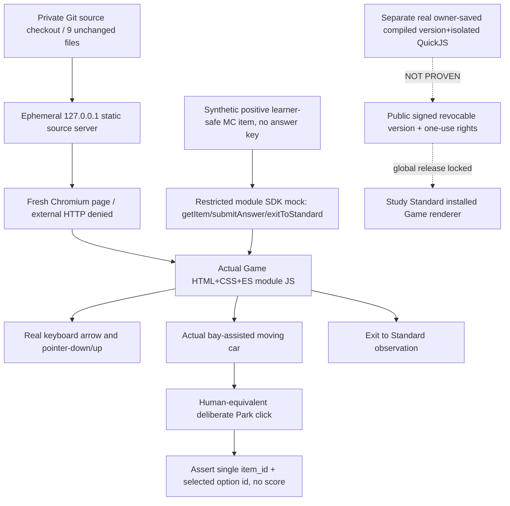

# Agent 3 — real authored Car Parking source Chromium and Module SDK acceptance

**Task:** `SV-CAR-PARK-REAL-AUTHORED-BROWSER-001` · **session:** `SV-A3-20261123-PARKING-AUTHORED-BROWSER-148` · **date:** 2026-11-23 Asia/Manila. **Exclusive frontend claim:** `005d00a7358b4e8335936feedc08585091ca242f`. Creator source starting head `240160ce4b4324b2b0791d46d1b430152d778aaf`.

## Goals, decisions and specific root cause

**Goal:** verify that the **actual nine-file owner-authored Car Parking Game** runs under a real Chromium browser with authored keyboard and mobile pointer movement, actual bay assistance, deliberate Park submission and Exit to Study Standard. This is a missing step between static source-format inspection and later isolated compiled/saved Game public acceptance. Previous source commit `4ca9e817ba30ab9270bf071480b4b4c7aa4c86e8` removed HTML markup incompatibilities but was only structurally inspected: no actual browser ever drove the moving Game, and none of its Node regression tests ran.

**Decision:** add a **private-repository-only**, credential-free Node loopback/static-source harness and Chromium Playwright test. It operates on the real source files read from this exact Git checkout (not hand-written replacement Game HTML). A minimal synthetic `GameSDK.module` stub supplies only the learner-visible `{id,item_type,schema_version,content}` and records normalized proposals and Exit, never answer keys, correctness or study scores. Deterministic traffic randomness keeps the browser regression repeatable without replacing the authored movement/physics or generated options. Block all browser external requests, listen on loopback, never send real source to Cloudflare Browser Rendering or public endpoints. Add a tightly scoped private GitHub Actions workflow triggered only by relevant source/tests and executable manually. No Game source, saved package, Wasabi, release signing, live UI, backend API or installed learner grades changed.

The existing owner source branch contains only Git **editable source**. It cannot prove newly compiled private saved v3 without a real owner-authenticated creator session. Never fabricate such a submission/receipt or reuse immutable v2. The current public zero-binding QuickJS frame lacks the real Game's JS-module/keyboard/pointer/RAF capabilities; a successful local Chromium source test **does not** qualify public isolated execution.

## Before → after

| Scope | Before | After |
|---|---|---|
| Real creator Game browser acceptance | Static HTML profile and 4 source-unit test cases committed; no source Chromium session | Add three real Chromium source tests: desktop keyboard+actual Bay 2 assisted path+Park+one `submitAnswer`+Exit, responsive held mouse/pointer steering+Exit, 25-choice rejection and Standard Exit without submission |
| Source/provenance | Nine existing exact source files with manifest hashes | All unchanged; real local ephemeral HTTP serves only those nine files, never a synthetic stand-in or source rewrite |
| SDK and user answer privacy | Renderer-only fixed `multiple_choice`, Study Standard trusted checker | Synthetic SDK responds `preview_only` only, records `{item_id,response:{value:'choice-1'}}`, never grades or discloses answer key |
| Source browser network | Browser execution had no automated network containment check | Route blocks all non-loopback external requests and asserts no attempted requests; dedicated incognito Chromium, no stored profile or real user account |
| Production Game release | Signed saved v2 immutable and unqualified; public player locked | Unchanged: no private v3 saved receipt, no public engine changes, no signing/guest grant, no app UI/manual |

## Logic and architecture

Specific browser cases: Desktop waits for actual option button nodes, checks no early submit, opens and Escapes the genuine accessible question modal, holds actual ArrowUp, verifies the car's rendered world position changes, focuses a real generated Bay 2 and enters to initiate the **real** assistance route, waits until the actual Park button becomes enabled, clicks Park, asserts exactly one normalized item response, then clicks top-right Exit. Mobile uses Playwright's real mouse pressed over the existing responsive touch arrow, checks movement without answer submission, then exits. A 25-option fixed-type item exercises real SDK `exitToStandard` without mounting broken road or submitting any answer. The response is `preview_only` and neither official nor private correctness feedback.

## UI and design

Adapt the **existing dark-blue Car Parking UI**, not a new design. No new production button or internal filename, no changes to visuals, keyboard labels, touch layout or question modal. Tests inspect existing UI states. The User Manual remains unchanged because nothing new is visible to learners/creators in production.

## Step-by-step implementation and rollback

1. Check frontend/Worker/creator HEADs and agent protocol, active shared claims, fixed-type renderer-only owner contract, existing private source manifest, previous markup compatibility report, real production QuickJS player and existing owner-local browser runner.
2. Claim **only** new private repo test, private CI workflow and report, plus shared frontend coordination ledger via nonforce exact-head CAS; preserve long-lived Agent 3 claims to source preview, ZIP, signer and candidate-origin tasks.
3. Write composable loopback-only source server, privacy-bounded synthetic SDK, three real Chromium source tests. No production/environment credentials.
4. Create private GitHub workflow using pinned Node 22 and Playwright browser, read-only checkout, workflow-scoped `contents:read`; run targeted existing two source suites + new browser suite on owner source branch, collect actual job conclusion/logs. Avoid blanket scans, build changes or public source transmission.
5. Commit under creator GitHub exact expected-head CAS; inspect GitHub Actions runs. If Actions disabled/unavailable or one case fails, record **not verified** and error evidence, do not claim passing; fix only demonstrated defect in a separate specifically coordinated source change.
6. Read-only production gate check and provider deployment versions. No new saved Game version or public Play; release own claim with exact-head CAS and measured evidence in docs.
7. Roll back new test/workflow/report via new nonforce expected-head revert, leaving all creator source files, manifest, saved v2, existing public Worker/SQL and Study Standard unchanged. If CI is red, do not treat the Game as qualified; the signed release gate is independently locked regardless of CI success.

## Executed acceptance and deployment evidence

Pending Git commit and private GitHub Actions readback. Never infer an Actions success from a commit or queue.
