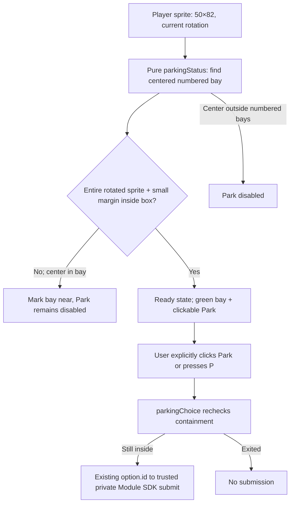

# Car Parking — Park button becomes available inside the numbered parking box

**Task:** SV-CAR-PARK-INSIDE-BAY-001 · **Agent:** 4, owner-directed narrow Game-source exception · **Date:** 2026-11-18 Asia/Manila · **Repository:** `georgekarlr/studyverse-games`, `stage-1`, existing private Car Parking project `4c84c21e-b797-4754-8d49-5134538dd468`.

## Goals, decision and cause

**Owner goal:** Once the player's car is **inside a numbered parking box**, the player should be able to click **Park** without having to deliberately stop to an artificially narrow speed threshold or align to a restricted heading. Existing game code in `driving-physics.js` only accepts x within a narrow central strip, y=150–223, speed ≤15, and a heading ≤36° from straight/180°. This means the player may visibly enter a parking box yet the actual Park button stays disabled. The button is gated directly by the pure `parkingStatus(...).ready` result through existing `parking-lot.js` `canPark()` and `main.js` `refreshControls()`.

**Decision:** Replace speed/heading restrictions with **physical box containment of the entire rotated player-car sprite**, not just its center. That matches “once the car [is] inside the box” and rejects false submissions when half the vehicle still crosses a bay boundary. Keep a small 5-unit safety inset inside the existing bay border. The actual player art is world-size **50×82** and rotates around its center, so an orientation-aware bounding envelope of half-extents `25 × |cos θ| + 41 × |sin θ|` in x and `25 × |sin θ| + 41 × |cos θ|` in y determines if the whole rotated car fits. The center must be inside the actual numbered bay rectangle (x `bay.x .. bay.x + bay.width`, y `bay.top .. bay.bottom`) to select its index. The ready flag becomes true whenever the rotated sprite plus margin lies within that rectangle, irrespective of current speed/heading. When only the center is inside but an edge still crosses the outline, the bay is marked near and guidance says “move fully inside the lines.”

## General logic and specific implementation

- `parkingStatus(car,track)` remains a pure function. It locates the only numbered bay whose rectangle contains the car center and then checks full vehicle bounds against that same bay. There is no cross-bay snap, new choice selection, new SDK call or client grade.
- The **existing** `parkingChoice()`, `canPark()`, `park()` and `refreshControls()` already derive from the same `parkingStatus`, so the button becomes enabled on the earliest game frame where `ready` becomes true; clicking Park rechecks current containment at the actual click time, preventing a fast-moving car that exited from being submitted as if still parked.
- The `parkingStatus` status copy will report `“Inside Bay N. Press Park to choose this answer.”` only when fully contained; near boundary copy instructs full entry. `options[index].id` remains the actual source and `GameSDK.module.submitAnswer` is invoked **only** on explicit Park, never on entering the box.
- Update the game's own user-facing `docs/car-parking-game-guide.md`, leaving shared `docs/USER_MANUAL.md` alone under Agent 3's existing claim. Update only `driving-physics.js` size/SHA-256 in project `.studyverse/source-manifest.json` (nine unique existing source IDs), not the owner binding or entry ID.
- The five independently moving traffic obstacles, 960-height road, original answer positions, assisted driving waypoint logic, dark full-bleed mobile UI, buttons and private Multiple Choice SDK all remain unchanged.

## Before and after behavior

| Scenario | Before | After |
| --- | --- | --- |
| Car fully within a numbered bay, angled/rotated | Park often disabled due to heading | **Park enabled** at any heading that visually fits entirely inside |
| Car fully within a numbered bay, speed above 15 | Park disabled | **Park enabled** (must still click while inside the bay) |
| Car center inside but vehicle protrudes past painted lines | May misleadingly be identified as near or excluded | **Park disabled**, bay highlighted as near; prompt to move whole car inside |
| Car between spaces or on roadway | Park disabled | Unchanged |
| Car crossed edge after button became ready | Park rechecks existing status | Unchanged; no stale answer submission |
| Assisted driving into a numbered bay | Stops, then may require manual alignment | At completed waypoints, Park enabled once wholly inside; no auto-submission |
| Traffic crash, question modal, locked game | Original collision/reset, paused and locked UI | Unchanged, Park never submits from non-playable state |
| SDK | Park submits offered `option.id` | Exactly same, no scoring or public Code Game unlock |

## UI and design — adapt existing design, not a new design

No additional panel or styling system: the current bright green ready bay and existing translucent **Park** button provide instant visual feedback, with the same keyboard `P` and touch/click behavior. The existing accessibility status guide announces near versus ready. Responsive camera, long roadway, five cars, parking boxes and dark-blue HoloSpace art remain unchanged. No internal filenames are displayed in-game.

## Architecture

## Step-by-step implementation and verification

1. Read refreshed `studyverse-games/stage-1` project `driving-physics.js`, `parking-lot.js`, `main.js`, current source-manifest and Car Parking guide. Check frontend root `AGENTS.md`, unified backlog, latest heads and canonical active Game leases.
2. Acquire an exclusive narrow external source claim in the canonical register through `main` exact expected-head, nonforce CAS, leaving Agent 3 Studio/Worker/Manual claims intact.
3. Commit this comprehensive plan **outside** the restricted Game project `source` directory.
4. Replace only the pure `parkingStatus` geometry in `driving-physics.js`. Keep established player/option/SDK methods unchanged. Update `docs/car-parking-game-guide.md` and the exact SHA-256/UTF-8 byte count of this one source in the project manifest; preserve all source IDs and owner identity.
5. Verify with actual pure-function deterministic cases across 2, 4 and 24 answer bays: centered cars at headings 0/45/90/180 and speeds 0/40/190 should be ready; near painted line, center outside, between bays, roadway and protruding rotation should remain unready; neighboring option index must remain correct. Parse JS source syntax, verify existing input/main code uses `ready`, and check unchanged file manifest entries and source-sync protocol.
6. Commit game source to `stage-1` using exact current expected head, `force=false`; read back branch and required files. Record true checks and rollback in plan and shared coordination ledger, release Agent 4 claim by CAS. Do not add test gates or touch production frontend, Worker, SQL or SDK.
7. To see the behavior, use existing private Local Game Studio's GitHub Pull to safely fetch the latest `stage-1` Car Parking source (mind unsaved local edits) and open **Private Preview**. Saved immutable Game versions are not changed by GitHub source edits.

## Rollback / acceptance limits

Revert only the new physics, synchronized source manifest and game guide against latest `stage-1`, preserving later unrelated changes. Do not erase answers, payments, source ownership, app snapshots or public release locks. A GitHub source update plus pure-function checks is **not** a verified authenticated browser/phone or real SDK-submission playthrough; explicitly record that limitation.

## Completed implementation and measured verification (2026-11-18)

**Implemented source revision:** [`ac057479b3f112733fe4cb78e5f4826fb58d1741`](https://github.com/georgekarlr/studyverse-games/commit/ac057479b3f112733fe4cb78e5f4826fb58d1741), parent plan commit `24c1687c3255ece9153bb72d425710b1ce55fe11`. Exactly three game-repository paths changed: `source/driving-physics.js`, `.studyverse/source-manifest.json` and `docs/car-parking-game-guide.md`. Replaced the existing narrow position/speed/heading parking gate with the actual numbered bay rectangle plus complete 50×82 sprite rotation-aware x/y envelope and a five-unit painted-line inset. Status now distinguishes center-in-box/partly protruding from fully contained ready. All existing gameplay and trusted answer-submission code is unchanged.

**Actual checks executed:**
- Pure source JavaScript syntax parsed and `buildTrack`, `parkingStatus`, `startingCar` evaluated for **2-, 4- and 24-answer bay tracks**.
- **108 positive cases**: car centered inside each sampled bay at headings **0°, 45°, 90°, 180°**, speeds **0, 40 and 190**; every case returned `ready=true` and exactly the expected original offered bay index, including first/second/last options.
- **216 near-boundary cases**: center inside but part of the rotated sprite protruding across top/side outline; every case gave `ready=false` while retaining the correct near-bay index and move-further-in guidance.
- **18 outside cases**: center on the road or past a bay bottom border; all `ready=false` and `index=-1`. Existing world height **960**, starting car at **y=877**, five-car traffic file, camera, controls, and original user-facing choice IDs unchanged.
- Exact former project manifest SHA-256 and UTF-8 source byte count were verified against actual file bytes before editing, using known SHA-256 test vector. New `driving-physics.js` SHA-256 is **`8087e4f28cf6605376bfb357a0158a8b3baab55fef27d5c66bd6e6ee1922b318`**, size **4,461 UTF-8 bytes**; existing nine unique source entries, original `multiple_choice` project and `entry_file_id=dd6068ca-007d-4d08-be05-9bc4f84db479` preserved.
- Independent GitHub `stage-1` post-commit readback confirms exact source commit, pure `inside` geometry, no stop/heading gate, updated guide and manifest, and only three expected changed paths. Unmodified engine `parkingChoice()` **rechecks** status at Park click, and existing `main.js` **enables** Park from `lot.canPark()` on state refresh: no automatic answer or client-side grade was introduced.

**Evidence limits / handoff:** This is committed and verified GitHub source plus pure code checks, **not** a signed-in Private Preview / mobile browser playthrough or a real SDK answer receipt. The owner can safely GitHub Pull this `stage-1` source in Local Game Studio (preserving any unsaved local edits), then open **Private Preview**. GitHub source edits do not retroactively change previously generated immutable Game versions and do not unlock public Code Game execution. No frontend/Worker/SQL or other production service was deployed. User-facing behavior is documented in the game's guide; shared `docs/USER_MANUAL.md` remains on Agent 3's separate claim.

**Rollback:** revert only physics, manifest and game guide against current game branch with expected-head CAS. No data, user grades, paid entitlements, public Game release controls or other agent work are touched.
