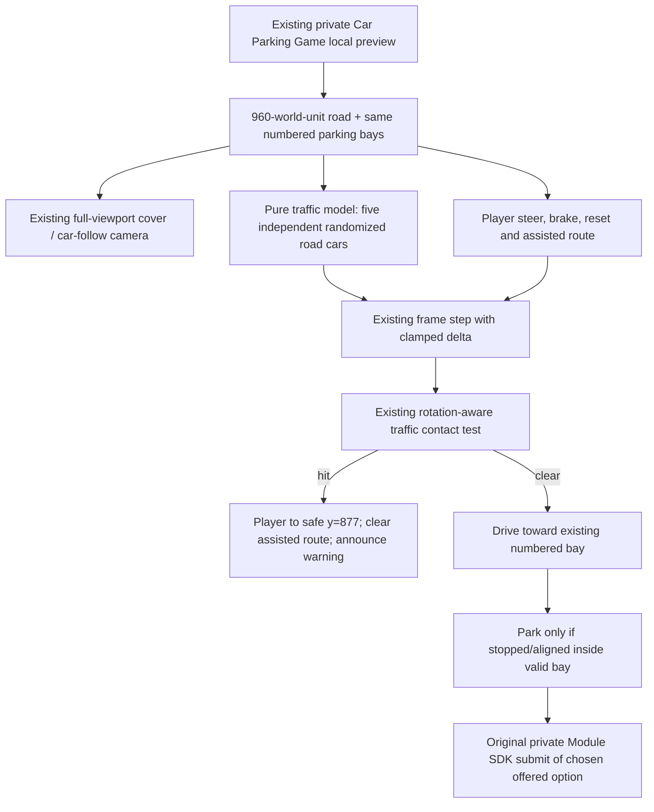

# Car Parking — longer START approach and five moving traffic cars

**Owner-directed task:** SV-CAR-PARKING-LONGER-ROAD-FIVE-001 · **Agent:** 4 (explicit cross-lane exception) · **Date:** November 18, 2026 Asia/Manila · **Repository:** private `georgekarlr/studyverse-games`, `stage-1`, existing Car Parking project `4c84c21e-b797-4754-8d49-5134538dd468`.

## Goals and decisions

Extend the driving distance from START to the existing numbered parking bays and add **two** independent randomly moving traffic obstacles to the **three** already shipped, totaling **five** AI cars. The extra road must be real navigable world space, not a zoom-only illusion. Preserve original bay geometry, numbered Multiple Choice options, player acceleration/steering and touch, collision reset/no grading, private Studio source-sync identity, full-screen camera and platform safety locks.

**Chosen concrete geometry:** `TRACK_HEIGHT` increases **620 → 960** world units (**+340 / +54.8% world height**). The player starts at **y=877** rather than y=537 (i.e. remain 83 units before the bottom boundary). With a parking target around y=192, the START-to-PARK distance becomes **685 instead of 345 units**, a **98.6% longer approach**. Numbered bays continue at y=70–269 and valid parking y=150–223. Five moving cars remain in **separate road-only horizontal bands** at centers **y=335,430,525,620,715**, with independent ±8-unit randomized wander and horizontal drive; none can touch a bay. The last traffic lane leaves >120 world units of clear approach to the starting player vehicle. Default world width and number of answer options remain unchanged.

**UI/design decision:** adapt the current dark-navy StudyVerse arcade and full-bleed camera, not a redesign. Add four dashed road markings separating the longer lanes; keep the cyan player vehicle, translucent keyboard/touch controls, Pause, Park and information UI. Retain old amber/rose/teal traffic and add violet and lime accents for cars four and five. No new panel or filename displayed in the game; all NPC traffic remains decorative and pointer-transparent.

## Verified cause and specific solutions

1. **Short course:** Physics constant `TRACK_HEIGHT=620`, `startingCar.y=537`, vertical world bound and camera use old height; road divider/bays are top-fixed, so there is only ~345 units to the answer bay. **Fix:** change physical world height and starting Y while keeping existing top parking coordinates; camera already uses the shared constant and supports vertical following/cropping. Update assisted driving waypoints to first align horizontally in the safer clear lower approach before traversing the traffic bands, preserving the “assisted drive never submits” rule.
2. **Only 3 AI cars:** pure traffic module declares `TRAFFIC_CAR_COUNT=3` and three hardcoded bands/offsets; world renderer already loops all cars, and CSS provides three colors. **Fix:** change to exactly five band rows and five start offsets in the same composable `createTraffic` path, retain `stepTraffic` timing/random reversals/bound reflection and `hitTraffic` geometry, add two CSS variants. Avoid copying AI logic or changing the trusted answer SDK.
3. **Road visual ends too quickly:** one lane stripe at y=435 and START near bottom of old lot. **Fix:** reposition stripes between traffic rows and draw a few extra evenly spaced world-space dashed markings. START marker remains bottom anchored and follows the longer world.
4. **GitHub Pull source integrity:** the project `.studyverse/source-manifest.json` records exact UTF-8 size/SHA-256 of all nine source files; any modified JS/CSS/HTML must be synchronized before commit. Preserve original file UUIDs, `entry_file_id`, `fixed_item_type=multiple_choice`, `source_files` order, owner binding and protocol.

## Before and after

| Feature | Before | After |
| --- | --- | --- |
| World length | 620 world units | 960 (+54.8%) |
| Player start | y=537 | y=877 |
| START→bay center | 345 world units | 685 (+98.6%) |
| AI cars | 3 randomly moving cars | **5** independently moving cars |
| AI bands | y=330,395,460 | y=335,430,525,620,715; five separated routes outside bays |
| Road markings | One dashed stripe | Five longitudinal progress separators for five road bands |
| Camera | Cover/full-viewport follow | Same responsive camera automatically follows extended world |
| Contact | Safe START reset and warning; never grades | Same; all **5** NPC vehicles cause safe reset |
| Assisted path | Travel to y=342, cross to bay x, then park | Approach a clear lane below traffic first, cross horizontally, then drive toward bay through traffic; no auto-submission |
| SDK / release | One original Multiple Choice ID on Park | Unchanged; private preview only and existing public Code Game release lock |

## General and specific logic

- `buildTrack` still creates the original x width, y fixed bays, `height=TRACK_HEIGHT`. `startingCar(track)` now uses `track.height-83` to place the player in an intentionally clear launch area. `stepDriving` automatically honors `track.height` for collision with world bounds, so existing acceleration and steering remains unchanged. `parkingStatus` retains its strict speed, heading and bay tests.
- `createTraffic(track,rng)` returns **five** independently seeded same-shape states, each with its own lane, random x, speed, horizontal direction and time until randomized change. `stepTraffic` retains per-car dt clipping, random heading reversal, speed and ±8 y drift; y plus visual half-height always stays below the y=270 divider. The start has no AI lane nearby. `hitTraffic` checks the same player/AI approximate rotated rectangles. Engine's existing array loop automatically renders all five.
- `assistedRoute` first stages a horizontal approach just above the START zone and below the last traffic band, then drives north toward the selected bay through all lanes. The player can interrupt with manual keys at any time. Collisions still clear waypoints and send the player safely to START, never submitting.
- Existing `requestAnimationFrame` updates all traffic only when the game is playable; the question modal and hidden tab freeze it. No new timer, network access, storage records, scoring or data-submission code.

## Architecture

## Implementation steps and evidence

1. Refresh both current GitHub repo heads and game source/manifest/guide, frontend `AGENTS.md`, unified task backlog, and live Agent 3 coordination claims. Confirm the previous three-car commit and current road physics; identify exact source files.
2. Secure an exclusive, narrow Agent 4 claim for this external Car Parking project and one canonical coordination entry with non-force `expected_sha` CAS. Do not edit or override Agent 3-owned Game Studio/Worker/frontend/Manual files.
3. Commit this full implementation plan outside the Game source folder; then implement `driving-physics.js` longer world/start/assisted waypoints, five-band pure `traffic-obstacles.js`, relevant `index.html` road stripes and `styles.css` geometry/five car variants, and amend the game's own guide.
4. Verify pure-source geometry for supported bay counts, start clearance, five deterministic RNG traffic motions over long steps, road-only y bounds/no traffic collision on start, collision on contact, assist waypoints and unchanged Park-only submission. Run JavaScript syntax parsing when available; do not claim real browser/SDK interaction without performing it.
5. Validate existing manifest entry hashes against actual current source, recompute exact UTF-8 bytes and SHA-256 hashes for every changed source, keep nine original unique entries and all ownership/entry IDs unchanged. Commit to `studyverse-games/stage-1` via `expected_sha`, `force=false`, reread changed files and compare repository head.
6. Append true source and model verification results to this plan and canonical frontend coordination change-impact ledger. CAS-release only this Agent 4 task; preserve peers' claims.
7. Owner uses existing GitHub Pull in Local Game Studio and launches **Private Preview**; this source update does not overwrite existing unsaved edits/immutable Game snapshots or unlock public execution. No frontend/Worker Cloudflare deployment is necessary.

## Rollback

Revert the specific game source/manifest/guide delta to previous commit on current `stage-1` with non-force expected-head CAS, preserving later unrelated work. Do not mutate project ownership, SDK/Study answers, stored user data, database, payments, or platform public Game release gates. Real signed-in Game Preview, mobile browser controls and SDK answer receipt are unverified until genuinely exercised.

## Actual implementation, independent source readback and measured checks

**Completed source commit:** [`21490f6becbcb3f5ee5a30bb18125b4a4c6ee51c`](https://github.com/georgekarlr/studyverse-games/commit/21490f6becbcb3f5ee5a30bb18125b4a4c6ee51c), parent plan commit `06ae5e95782685df7fe4ed45dfcd610ac9f5f0c6`, on the existing private game `stage-1` branch. Six changed paths: current game `driving-physics.js`, `traffic-obstacles.js`, `index.html`, `styles.css`, source manifest, and existing `docs/car-parking-game-guide.md`; no source entry/owner binding or other code path. `parking-lot.js`, `main.js`, `studyverse-session.js`, Studio frontend, Worker, SQL and SDK are untouched. Thus the existing renderer creates **five** NPC DOM nodes automatically from the five-state traffic model, and all use the same existing collision reset/no-grading callback.

**Verified changes:** TRACK_HEIGHT **620→960**, player start y **537→877** using `track.height-83`, target parking y~192 unchanged; START-to-target distance **345→685** world units (**+340, +98.55%**). Assisted drive's horizontal staging waypoint from start becomes y=815 (below the last traffic car y=715) before driving north through moving traffic; near-bay starts do not retreat to the far road. Exactly **5** independently randomized traffic bands at y=335,430,525,620,715 with independent x offsets and random speed/reversals/wander; new fourth violet and fifth lime car paint, 5 world-space dashed road separators at y=382,477,572,667,762; the player, HUD, mobile controls and camera design remain unchanged.

**Pure deterministic code checks actually executed before commit:**
- SHA-256 implementation passed known `abc` vector; existing GitHub **byte-for-byte file sizes and SHA-256 values** for the four touched original source entries were confirmed against the pre-edit project manifest before updating it.
- JavaScript syntax parsed for both modified pure source modules. Pure `buildTrack`, `startingCar`, `assistedRoute`, `createTraffic`, `stepTraffic`, `hitTraffic` were evaluated with seeded random sources for **2-, 4- and 24-bay world widths**.
- **4,000 frames per width at 0.05 seconds per frame** (12,000 total physics frames; 200 seconds per width), **60,000 nonzero AI x advances**, **464 direction changes**, all five car centers strictly within horizontal road limits, footprints below y=270 numbered bay divider and within driving area; no initial collision at START. Direct contacts with the **new fourth and fifth cars** were verified to return true. The new assisted starting waypoint was verified at y=815; valid bay geometry was unchanged.
- Manifest remains the original `studyverse-github-source-tree-v1` protocol, **9 unique source file IDs and paths**, exact UTF-8 lengths and SHA-256 values for all four changed source files; fixed Multiple Choice type and original `entry_file_id=dd6068ca-007d-4d08-be05-9bc4f84db479` remain unchanged. The game guide now explains five cars and the longer route.
- **Separate GitHub post-commit readback:** `stage-1` at exact source commit, correct `TRACK_HEIGHT=960`, `start=track.height-83`, five traffic bands and offsets, five HTML dashed road marks, CSS fourth/fifth car definitions, guide five-car update, intact original entry/type and nine source-manifest entries. GitHub compare to plan commit shows **only the expected six modified paths**.

**Evidence limitations:** These are actual GitHub source and pure-model tests, not a browser, full game-device, logged-in private preview or real SDK-answer test. No standalone game origin or Cloudflare Pages/Worker deployment performed. The already open Local Game Studio does not automatically replace unsaved source, previous immutable Game snapshots or published Game apps. To play the new version, safely pull the latest **`studyverse-games/stage-1` Car Parking** source into the existing Local Game Studio and open **Private Preview**. No public Code Game release lock was altered.

**Rollback:** reverse only the above six game-source/manifest/guide changes to the preceding game commit using the current `stage-1` expected-head CAS, retaining all subsequent unrelated commits and preserving source IDs, authentic paid/account state and public Game locks. The user guide already reflects the new in-game behavior; the separately Agent 3-claimed main StudyVerse User Manual has not been edited.
