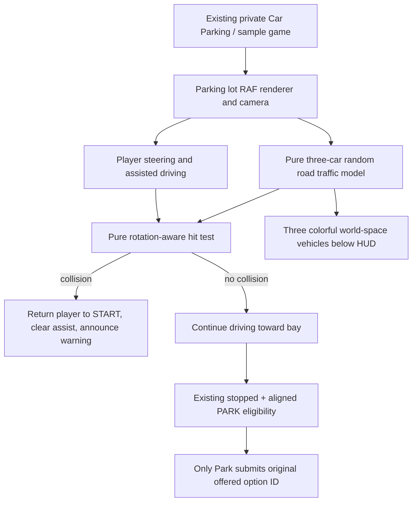

# Car Parking — three moving traffic obstacles

**Task:** SV-CAR-PARKING-MOVING-TRAFFIC-001 · **Owner-directed Agent 4 Game-source exception** · November 18, 2026 (Asia/Manila) · private `studyverse-games` repository, `stage-1` branch, existing Car Parking source project.

## Goals, decisions, before and after

The owner wants **exactly three moving cars as randomly moving obstacles** on the **driving roadway outside the parking bays**. The current Car Parking game has one player car and static road; its world is 620 high, with numbered answer parking bays between y=70 and 269, road below y=270, and the player's start at y=537. There are no moving obstacles or hit responses.

**Decision:** reuse the current full-bleed HoloSpace road, cyan player car, dark-blue asphalt, responsive cover camera, transparent steering controls, private Multiple Choice SDK and fixed car-parking project. Add **three** visually distinct amber, pink and teal road cars with independently randomized speed, direction, turnaround intervals and gentle within-lane vertical drift. Cars remain in road-only lanes with centers near y=330,394,458 and never enter numbered answer parking bays. Their starting positions avoid the player's starting location; a hit returns only the player to START with an accessible warning, clears any assisted route, and never submits an answer. Player can simply steer around the moving traffic and still access all bays. One collision is not a grade, game completion or charge.

| Area | Before | After |
| --- | --- | --- |
| Traffic | No AI vehicles | Exactly three colorful, independently moving random AI cars on the road |
| Motion | Single user-controlled car | Randomized per-car speed, direction, timing and small lane-relative wandering; 60 Hz world updates with bounded delta |
| Spaces | Empty number-labeled answer bays | Unchanged; traffic never drives into parking spaces or masks choices |
| Contact | No traffic hit mechanic | Contact resets the player's car to the safe start and announces collision; no option, grade or progress is submitted |
| Auto drive | Moves along existing waypoints | Still follows existing route, but like manual steering can encounter traffic; crash clears assisted route |
| Pause, reset | Player simulation | Question modal, hidden tab and locked state freeze all AI movement; pressing Reset returns the player to start; next round rebuilds three AI cars |
| StudyVerse SDK | Private Multiple Choice, official Park-only answer | Exactly unchanged; no answer key, score, release permission or public Game unlock |
| UI | Responsive dark-blue full-viewport game | Same UI; traffic models rendered behind player without new overlays, buttons or game filenames |

## Specific root cause and solution / implementation details

**Root cause:** `createParkingLot` currently only steps `stepDriving` or `driveAssisted` in requestAnimationFrame. The game markup contains one `.car` element. Neither moving NPC model nor collision geometry exists, and the source-manifest checksums enforce exact content identity for the Game Studio GitHub source pull.

**Specific solution:** compose a new **pure** `traffic-obstacles.js` simulation with `createTraffic(track,rng)`, `stepTraffic(cars,dt,track,rng)` and `hitTraffic(player,cars)`. Three independent agents have safe x boundaries, separate horizontal bands all below y=270, random velocity/timer changes, and smooth y movement with bounded oscillation. The contact test uses the player's approximate rotation-aware footprint against horizontal traffic vehicles; no state mutation of the answer, module, player ID or session.

Integrate traffic rendering and motion into existing `parking-lot.js` RAF without touching trusted answer-checking code. Mount exactly three pointer-transparent, `aria-hidden` decorative DOM cars in a new world-space layer inside the existing parking-lot element; no canvas, API, network, timers or external dependencies. On collision restore the player to `startingCar(track)`, stop motion and assisted waypoints, keep AI road motion and call a narrow `onCollision` callback in `main.js`. This reports through existing `announce` and does not call `GameSDK.module.submitAnswer`. Existing `setPaused`, `lock`, `reset`, private sample and SDK paths govern AI progress as well.

The new module is referenced only by the existing `parking-lot.js` module, not public application routes. Update `source-manifest.json` with exact UTF-8 byte lengths and SHA-256 digests for each touched existing source file plus a new stable UUID entry for the traffic module. Retain original entry UUID, owner binding, original file IDs and fixed `multiple_choice` type. Keep documentation **outside** the GitHub source tree so the Game Studio importer doesn't treat it as executable project source.

## General and specific UI; adapting current environment vs new design

**Adapt current game design, do not redesign.** Three road cars in amber, rose and teal contrast with the player's cyan car while inheriting the existing rectangular car art, dark-blue road shadows and world-camera zoom. Their CSS is in the existing stylesheet; roadway traffic layers appear below the player's z-index, behind HUD and buttons. All traffic elements have `pointer-events:none` and `aria-hidden=true`: keyboard and touch controls, numbered answer choice buttons and modal remain usable. Existing screen-reader live status announces a collision; new guidance is added to the game's own guide. Keep mobile/landscape full-screen, scrolling behavior, touch pointer capture, Escape and X exit unchanged.

## Architecture

## Step-by-step implementation and verification

1. Read latest default `stage-1`, exact game directory, physics, renderer, styles, main, HTML, manifest and the existing Game guide; read Studio root AGENTS, canonical ownership and all active Agent 3 claims.
2. Acquire narrow cross-repo owner-authorized claim on only the external game project, guide and new plan, with non-force exact-head CAS; do not edit Agent 3's frontend, Worker, Game Studio, General SDK, manual or progress.
3. Save this plan outside the restricted source directory before source changes.
4. Implement the pure three-agent traffic module, world-space visual layer, collision/reset callback and optional assist interruption, update same design stylesheet and guide.
5. Check old source-manifest digest against the unchanged GitHub file to validate byte hashing. Recompute exact SHA-256 and byte sizes for new/modified source. Ensure no game source file is omitted, no duplicated path or ID, and no owner binding or fixed item type change.
6. Use bounded deterministic model/source checks where tools allow; do not claim an actual local/production browser drive without evidence. Do not initiate StudyVerse production payment, Game submission, public Code Game execution unlock or deployment.
7. Commit on game `stage-1` with `expected_sha`, `force=false`, reread source/manifests and newest head, and hand off for Studio's **explicit GitHub Pull / Private Preview** workflow. The changes to GitHub aren't automatically applied to any already-open local unsaved source or existing immutable application snapshot.
8. CAS-release the canonical claim, preserve all Agent 3 leases, and record exact commit and verification evidence.

## Rollback and limits

Revert just the Car Parking traffic change and synchronized manifest to the preceding source commit using the current branch head (no force). This restores the prior traffic-free gameplay without affecting SDK contracts, user content, published immutable versions, SQL, frontend/Worker or financial data. No provider deployment or real browser/SDK acceptance may be claimed without actually performed verification.
