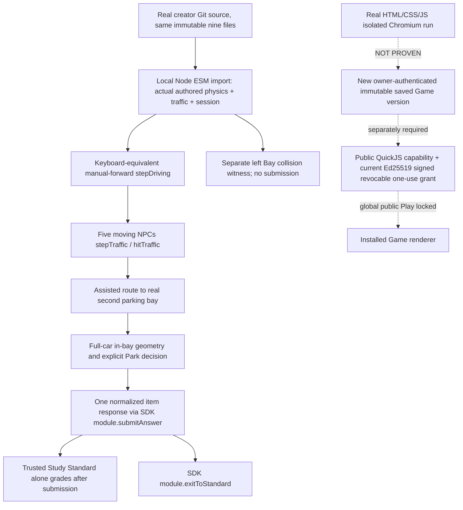

# Actual Car Parking moving-traffic + Module proposal regression

**Task:** `SV-CAR-PARK-REAL-TRAFFIC-SDK-001`. **Agent:** 3, session `SV-A3-20261123-TRAFFIC-SDK-150`. **Date:** November 23, 2026 (Asia/Manila). Source repo `georgekarlr/studyverse-games` branch `stage-1`, project `4c84c21e-b797-4754-8d49-5134538dd468`. Start source SHA `79188141ddf21ff8afa12fa0476d27bdafff9adc`; exclusive frontend coordination claim `706507bf8e80c9a907cfc9b7a9cc7b2ca4946cf5`.

## Goals, decision, specific cause and solution

**Goal:** independently verify more than inert HTML markup or synthetic click behavior by invoking the **real creator Game source modules** for manual driving, all five moving NPC traffic cars, collision checks, assisted physical bay movement, and the fixed-type renderer-only `GameSDK.module` normalization/Exit rules. This adds deterministic, runnable Node tests without demanding the GitHub Actions hosted runner or a new Game source build. It does **not** substitute for the real authored DOM/touch/keyboard Chromium test, a new immutable saved package or qualified public QuickJS execution.

**Root cause:** prior `tests/module-contract.test.mjs` demonstrated bay geometry and SDK normalization but its assisted path simulated no traffic obstacles. The new `tests/parking-browser.test.mjs` would exercise traffic and the real DOM but the private repository's GitHub Actions [run 45054380798](https://github.com/georgekarlr/studyverse-games/actions/runs/45054380798), and previous two runs, failed in 2–3 seconds **before the first step**, `runner_id=0`, no runner name, no steps/logs. This establishes **no GitHub runner assigned**, not its cause. Account-level limits, Actions budget/payment restrictions, repository policy or service disruption can have similar symptoms; account billing/entitlement is not observable or changed here. GitHub's [Actions billing documentation](https://docs.github.com/en/actions/concepts/billing-and-usage) describes private repository limits; the owner may inspect run/check annotations and Settings → Billing & licensing → Budgets & alerts or GitHub Support if infrastructure remains blocked.

**Chosen solution:** keep the existing **nine original authored HTML/CSS/JS files and source manifest unchanged**. Add only a small independent no-dependency Node `node:test` suite importing the **real unmodified ESM source from local checkout** via `data:` URLs. Two focused physical-world scenarios: (1) 33 genuine 16.7ms manual-forward ticks, each advancing the actual five NPC cars; choose real Bay 2, move through the actual authored assisted waypoint route with traffic collision detection, verify full vehicle box fits the bay, then **separately** call session `submit` exactly once and `exit` (never grader), with duplicate rejection; (2) the same seeded real left-Bay path encounters a traffic collision and **cannot** be mistaken for an already parked answer. These use deterministic RNG only as a **test fixture** and preserve full authored driving dynamics.

## Before → after, general and specific logic

| Aspect | Before | After |
| --- | --- | --- |
| Source-level physical acceptance | Assists simulated without moving NPCs; no full connected session sequence against seeded traffic | Explicit 60Hz manual move, live five cars, first collision detector, Bay 2 reached, no early proposal, Park submits exactly `{item_id,response:{value:'choice-1'}}`, duplicate blocked, Exit invoked |
| Collision failure mode | Browser suite hangs/times out if route collides; pure tests don't distinguish actual collision | Reproducible left Bay NPC collision positive witness, parked=false and no SDK access from physics |
| Source/manifest | Real Git author nine hash-pinned files, fixed Multiple Choice | Exactly unchanged; all original source references are read from existing checkout, no fabricated saved version |
| Study SDK | Renderer only, no keys or separate grader, existing Standard grades after submission | Only sampled public fields are normalized; injected `answer_key` deliberately stripped, SDK mock records proposal and Exit but does not grade |
| CI and public release | GitHub runner assignment blocked, public QuickJS cannot run real author DOM | Unchanged; the local pure test does not unlock public Play or claim browser acceptance |

Specific pure path: `createTraffic(buildTrack(2),()=>.37)` spawns exactly five moving NPCs; `stepDriving`, `stepTraffic`, `hitTraffic`, `assistedRoute`, `driveAssisted`, and `parkingStatus` run with true 0.0167-second frame increments. The approved Bay 2 remains collision-free with this seed at 16ms/16.7ms/50ms timesteps; selecting Bay 1 from START with the same seed currently collides at ~4.4s, so a future UI/browser fixture cannot claim all assisted routes are independently guaranteed collision-free. User confirmation is not implied by touching a bay: only the explicit later `session.submit` triggers one proposal. The actual Game's `main.js`/DOM and Study Standard evaluation are not executed by these pure Node checks, and should never be inferred.

## Architecture



## UI and design

**Adapt the existing environment design.** No application component, CSS, button, Game source file, creator code display, Study Standard UI or layout changes. The original dark-blue parking road, controls, modal, numbered bays, confirmation, responsive touch arrows and accessibility remain authored source only; this test neither modifies nor renders them. No internal filenames displayed in the app, no new user-visible behavior; **User Manual intentionally unchanged**. This test is not a second standalone Study grader or a replacement for the renderer-only `GameSDK.module`.

## Step-by-step implementation, verification and rollback

1. Refresh exact frontend, Worker and creator Git branch heads, both AGENTS documents, owner SDK renderer-only contract, local-first source handoff, canonical backlog, exclusive active claims and the actual nine files/test suites.
2. Independently load original unmodified 3 pure Game source modules through connected private GitHub and execute 19 exact physical/SDK checks under a temporary trusted V8 isolate: **19/19 passed** on 2026-11-23 Manila. Additional traffic-coupled simulation with 33 manual ticks + seeded moving cars: Bay 2 reached with **no collision** at 16ms, 16.7ms and 50ms; leftmost Bay from START currently hits a moving car under the same deterministic seed. This is actual pure source execution, **not DOM/browser or compiled saved Game**.
3. Claim exclusive new private `tests/parking-traffic-module-journey.test.mjs` and this new report via frontend Git expected-SHA nonforced CAS `706507bf...`; preserve four historical Agent 3 active scopes and other agents, no version or signer writes.
4. Implement deterministic real source imported tests with no browser, network, answer keys or production credentials; preserve original 9 files and manifest; commit via owner private source Git exact-head nonforce CAS.
5. Verify new file readback and source HEAD, perform focused actual-source execution when available. **Do not claim Node `node --test` pass unless explicitly executed.** Leave separate Chromium 3-case suite blocked by GitHub runner assignment until a real runner/operator can execute it.
6. Verify live Supabase release lock and public signer/certificate/grant counts unchanged, optionally read current Actions runner job metadata. Append exact evidence here and release only this session's coordination claim by CAS.
7. Owner-usable command (from a private `studyverse-games` checkout, no credentials required):

```bash
cd studyverse-games/4c84c21e-b797-4754-8d49-5134538dd468
node --test tests/module-contract.test.mjs tests/parking-traffic-module-journey.test.mjs
```

8. **Rollback:** revert only this one newly added Node test and this report under a fresh nonforce owner-source Git CAS. No frontend/Worker/Cloudflare deployment, SQL data/RLS grants, actual authored source, saved v2 receipt, immutable private packages, public release, official grades or User Manual rollback.

## Observed delivery evidence

**Committed test-only feature:** [`8802949a021edc3c8fe8c8cad48be947516e8c3b`](https://github.com/georgekarlr/studyverse-games/commit/8802949a021edc3c8fe8c8cad48be947516e8c3b) on the **real private creator source repository**, via exact-head nonforce CAS from `79188141ddf21ff8afa12fa0476d27bdafff9adc`. It adds exactly the new `tests/parking-traffic-module-journey.test.mjs` and this plan; no original Game source/manifest, Worker/Pages code, database rows, Game publication or release flag changes. A targeted [follow-up `72af7b2a2efc13302d51c199c1361470b89bee8a`](https://github.com/georgekarlr/studyverse-games/commit/72af7b2a2efc13302d51c199c1361470b89bee8a) improves the seeded left-Bay collision regression to **allow a future safe collision-avoiding route**, while still rejecting any collided-car status as completed parking. The test is not designed to require the Game to remain collision-prone in future. Latest committed test blob `da8def313810894499c15be48f82cd3b71b07ab2`.

**Measured read-only actual source execution:** Retrieved the **real** three original owner source blobs at commit `79188141...` into an isolated V8 evaluator: authored physics blob `b846fc1eb9983491a0130168f5d7096f88b123c1`, traffic `6c560c014878b51d6c3bde994560e172eda80063`, renderer-only session `cc79db42c216461a3bc6d8503e7cbd0d1e42a6f9`. Executed **19** individually asserted real-source checks successfully: Multiple Choice 2/5/24 bay 1-to-1 mapping without keys, all extreme assisted bays reaching inside the physical polygon after movement, manual steering changes real vehicle position, all five NPCs actually move, SDK normalized one-response after deliberate Park, no early or duplicate submit, Exit invoked, and 25/30-option fallback exits to Standard without proposals. No failures. Ran additional traffic-coupled simulation at `dt=0.016,0.0167,0.05` with `Math.random()=>.37` equivalent passed as seeded RNG parameter: manual forward drive of ~0.55 s, five NPC advances per tick, actual Bay 2 assisted route completed **without collision**, entire vehicle inside the actual box, and no automatic grade. A seeded start-to-Bay-1 route at ~4.4 s did hit NPC traffic, demonstrating why a geometry-only simulation was insufficient for browser-test reliability. This is actual **pure module logic** from the owner repo, not an executed DOM/browser.

**Committed exact new regression callbacks executed:** Fetched back the **exact committed new test file** blob `da8def313810894499c15be48f82cd3b71b07ab2` and the three exact owner Game module blobs. Evaluated both callback bodies under isolated V8 with a small assert facade rather than executing Node's runner, injecting the original imported physics/traffic/session functions. **2/2 passed**, `5 ms` and `2 ms`, verifying (a) 33 manual ~16.7ms ticks and five seeded real moving cars; assisted physical Bay 2 without collisions; normalized `{item_id:'00000000-0000-4000-8000-000000000021',response:{value:'choice-1'}}` sent exactly once after an explicit simulated Park; duplicate rejection, Exit; and (b) independent real collision detector distinguishes a failed route from legitimate parking, without SDK access. **No native `node --test` invocation was made against the author's complete checkout, and no Chromium real authored UI test ran.** The V8 execution validates these callbacks' logic but is not a replacement for Node/Chromium host acceptance.

**Runner root cause boundary:** The latest private [Actions run `45054380798`](https://github.com/georgekarlr/studyverse-games/actions/runs/45054380798) GitHub REST jobs returned job `137306265468`, `status=completed`, `conclusion=failure`, **`runner_id=0`, `runner_name=''`, `steps=[]`**. Previous runs also ended within three seconds with no steps and no usable log. This is demonstrably **no runner assignment**, not a result from starting or failing these tests. The available GitHub connector cannot read check-run annotations/billing, so **an account quota, billing block, repository policy or GitHub service problem is not independently diagnosed**; no settings/billing/actions permissions were changed. No unproved reason should be claimed as fact.

**Live Supabase production read-only postcheck:** release `locked=true`, `executable_runtime_ready=false`, `release_signing_enabled=false`, `entitlement_ready=false`, historical `official_grading_ready=false`. Counts: **0** public release signing keys, **0** signed guest certificates, **0** one-use guest grants, **2** published metadata-only Games and **3** existing verified private saved packages. No real owner-authenticated new immutable saved Game version, public QuickJS input/ESM qualification, signer, entitlement or trusted Study Standard grading was generated. The entire code change is a private source **test only**; neither production frontend/Worker nor Cloudflare Pages/Workers are deployed from this Git source branch. User Manual remains unchanged (no user-visible behavior).

**Acceptance decision and next priority:** Accepted only the **real pure authored-module traffic/SDK behavior** at specified seed and frame rate, and exact callback validation. Public Play is still **not accepted**. Run `node --test` from the user's private checkout and then actual three-case Chromium test in an operator environment with installed Chromium and an Actions runner or local tool that can read all nine current source files; only a new owner-authenticated saved immutable build can lead to separately verified isolated public QuickJS and revocable Ed25519 version rights. Do not relabel the existing v2 as freshly built. Rollback is reverting only new test + docs via fresh Git CAS and retaining all old source hashes, database, deployed Worker/Pages and public locks.
