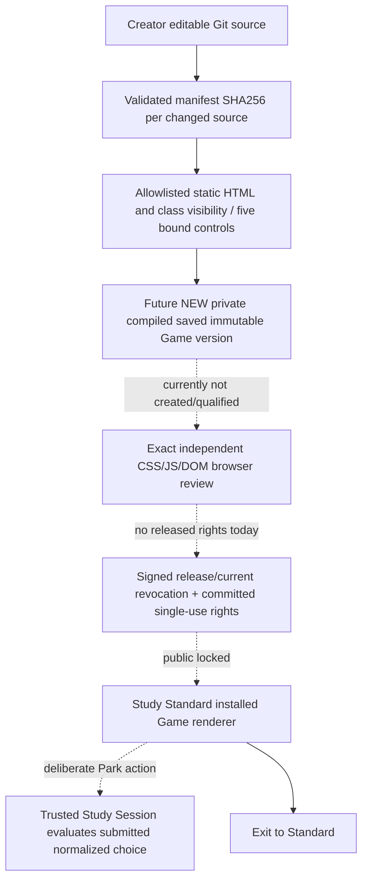

# Real authored Car Parking — bounded HTML/controls compatibility (source-only)

**Task:** `SV-CAR-PARK-STATIC-MARKUP-BOUNDED-001` · **session:** `SV-A3-20261123-AUTHORED-MARKUP-147` · **owner source:** `georgekarlr/studyverse-games`, branch `stage-1`, project `4c84c21e-b797-4754-8d49-5134538dd468` · **as of:** 2026-11-23 Asia/Manila. **Source starting SHA:** `84f13cf7a807c3ea8b45a76fc5e0a497d25d6f20`. **Shared exclusive CAS claim:** `1a2ac86b362ed3fc4115f4427b26e82a8fce80d7`. This is a **future editable Git source revision** only; the current private published saved v2 and public runtime remain immutable and unqualified.

## Goals / decisions and specific root cause

Real creator Car Parking uses one fixed `multiple_choice` Module and actual nine-file HTML/CSS/JS. Source screening on saved v2 and exact current public isolated player profiles indicated one unsupported HTML element (`ol`), five `data-drive` attributes and four `hidden` attributes. **Only tags `ul`, `li`, `button`, `div` etc. and bounded attribute allowlists are supported** by the current isolated frame. In addition, the static source JS referenced the unsupported `[data-drive]` selector and `button.dataset.drive`. Dynamic DOM and non-click input remain separate real runtime gaps.

**Decision:** adapt the existing Game design rather than creating another Game or rewriting it to a fake button demo. Update exactly the unsupported initial markup/one-to-one drive mappings/modal visibility, preserve keyboard/touch hold-to-drive, animation, physical parking, existing private preview, modal semantics, one-response SDK and Exit to Standard. Keep current saved v2 immutable; refresh only the **editable Git revision manifest** using actual UTF-8 sizes/SHA-256 with verified prechange hashes.

## Before → after

| Detail | Before | After |
| --- | --- | --- |
| Numbered choice list | `ol` rejected by public HTML allowlist | `ul` supported; existing manually numbered choice text/list CSS preserved |
| Touch drive controls | five disallowed `data-drive` attrs, broad selector and `dataset` | exact five allowlisted IDs mapped to the identical five input command names; pointer release/capture and keyboard controls unchanged |
| Dialog/Exit/Sample initial visibility | four unsupported `hidden` attrs and dynamic `.hidden` setters | same visible/hidden states with `.is-hidden{display:none!important}`, composable class toggle; accessible dialog/Exit remain visually and semantically hidden until requested |
| Modal reference and focus | `[role="dialog"]` query and complex unsupported `:not` selector | explicit trusted ID, enumerated known focusable buttons in their actual DOM tab order; Escape/Tab wrapping/restoration and backdrop pointer close retained |
| Creator metadata | nine hash-pinned source files | same nine; only four modified source sizes/hashes updated and separately checked; exact fixed type and source identity unchanged |
| Production signed saved v2 | immutable, existing public player can't execute authored car | unchanged. No saved version upload, signing, entitlement, grant, Studio/Study UI or public Play unlock |

## General & specific logic

1. On first load, all four previously hidden controls/surfaces have an `is-hidden` class, which uses `display:none!important`. The same state transitions in `main.js` and `question-dialog.js` add/remove the class instead of setting a DOM `hidden` property. The class is not user-controlled data or a privileged action.
2. Exactly five static IDs (`drive-forward`, `drive-reverse`, `drive-left`, `drive-right`, `drive-brake`) are the authority for directional button mapping; all five still reach the same `lot.setDrive(command, pressed)` and `pointerDrives` tracking. No source-generated answer or hidden key is used to choose a bay.
3. Dialog's visible list remains fully numbered via existing `option-number` DOM text. The `ul` changes only container semantics, not order, selection, displayed answers or layout. Explicit trusted modal panel ID avoids an unsupported role selector. Tab stays within the same four known controls when visible; keyboard Escape closes, restores focus, or falls back to the info trigger.
4. Editor project source manifest remains `studyverse-github-source-tree-v1` with the same project/entry-file IDs, nine paths, fixed `multiple_choice` and no media. All four originals matched the old manifest's byte SHA-256 and sizes before editing; the four replacements get recomputed SHA-256 and UTF-8 sizes. No saved v2 private package bytes, version, DB receipt, release signature or cloud storage are modified.
5. The public player uses QuickJS with only an inert bounded DOM and user click; the REAL Car Parking still imports modules and uses key/pointer/animation/timers/geometry. Existing **private input-capable** QuickJS development modules are not evidence that the **deployed public** player supports this Game. This milestone removes known HTML parser incompatibility **only**. A fresh private compile/saved v3+ version and independently qualified end-to-end browser test are required before signing/public release; leave the global gate locked. The creator-only General SDK remains separately multi-type. Learner `GameSDK.module.getItem()` stays answer-key-free; Study Standard evaluates after deliberate `submitAnswer`, Game does not grade.

## Architecture

## UI design (general and specific)

**Adapt current dark-blue Car Parking screen and StudyVerse Study Standard**, no new design. Same visible five touch arrows, gear/speed dashboard, numbered parking bays, question modal, Exit, sample buttons, accessible focus trap, mobile sizing and keyboard navigation. Only internal DOM semantics and hidden-state implementation change. No internal filename displayed in application UI; no new labels or behavior are promised to live users. User Manual unchanged because neither the production UI nor a verified saved package was changed.

## Step-by-step implementation, acceptance, rollback

1. Refresh source HEAD, canonical frontend/Worker branches, AGENTS/backlog, source handoff and active claims. Read real Game's nine-file manifest, actual HTML/CSS/JS and the current production QuickJS frame allowlist; confirm 1 unsupported tag, five data attrs, four hidden attrs, with selector/focus dependencies.
2. Claim precisely four editable source files, source manifest, one new focused test and this report using shared frontend `expected_sha` and `force:false`; reserve no existing Agent 1 Study API/SDK, Agent 2 Course, historical Agent 3 Studio/ZIP scope or public security gate.
3. Check SHA256 byte-for-byte and UTF-8 size against current source manifest before editing (done: 4/4 matched). Replace only specific tags/attrs, composably map five explicit drive IDs, preserve all original Game callbacks, add CSS hidden utility and modal focus list.
4. Static-verify the new initial HTML profile and control mapping, original value-to-option normalized SDK contract, exact refreshed byte SHA256 and remaining source paths; include focused node:test regression cases. No claim of a Chromium/browser runtime, grading, fresh saved compiled version or published public Game.
5. Commit to existing creator GitHub `stage-1` with expected-head nonforce CAS; read back actual source and updated manifest; record true success/failure of tests and native deployments (this private source repo is **not** the production Worker/Pages).
6. Append verified impact and release only this session's coordination claim with frontend expected-head nonforce CAS; leave four old historical claims intact.
7. **Rollback:** restore original four files and exactly matched four old manifest SHA/sizes from starting immutable Git commit under fresh nonforce CAS; ensure no new immutable saved version is rewritten. No SQL, public app deployment or User Manual rollback necessary.

## Actual implementation / verification

**Creator GitHub commit released:** [`4ca9e817ba30ab9270bf071480b4b4c7aa4c86e8`](https://github.com/georgekarlr/studyverse-games/commit/4ca9e817ba30ab9270bf071480b4b4c7aa4c86e8) on existing `stage-1` branch, pushed through a non-forced exact-head CAS from `84f13cf7a807c3ea8b45a76fc5e0a497d25d6f20`. Files changed: four actual author source files, the single existing project source manifest, new scoped test file, this operator report. All original four file hashes and UTF-8 byte sizes matched their own prechange manifest exactly before edits. Nine-source-file project identity and fixed `multiple_choice` type were preserved; source document tree was re-read at the exact source commit.

**Measured postcommit structural checks:** Compared the actual new Game body against the current public player `frame.mjs` initial DOM tag and attribute allowlists using source-level structural matching. **88 HTML elements, 167 attribute occurrences, zero unsupported elements or attributes** in this bounded inspection. `ol` changed to allowlisted `ul`; five `data-drive` attributes replaced by unique IDs with one matching command each; four original `hidden` attrs removed in favor of the same CSS-hidden initial state. The static checks verified the controller no longer uses `dataset.drive`/`[data-drive]`, visible state no longer uses `.hidden=`, and all five pointers/keyboard listener declarations remain in source. Focusable modal options now reference bounded explicit IDs. These checks inspect source structure and exact search patterns; **not** full browser DOM/CSS runtime acceptance.

**New manifest source pins (recomputed UTF-8 bytes):**

| Modified source | New size | New SHA-256 |
| --- | ---: | --- |
| index.html | 6,438 bytes | `92880ba1fa3cb8f72a5704147b1135476ddcf85a523fd01ca7c9a37124ce4252` |
| main.js | 9,822 bytes | `c33f86940fec451533fd5f6780313e59bbb6db797e933b1b69639e6757aa4fd9` |
| question-dialog.js | 2,542 bytes | `cf3bd5980d21d80e5a4dd7ee6b49e7d0202cf475ddb74fecc6353d0e536590d2` |
| styles.css | 18,847 bytes | `0262b82b91f6c724372777f2e4773ce39e9543cfef3e89f835a20bff148e5d8d` |

**Regression evidence limit:** Added four targeted Node `node:test` cases for markup allowlists, 5-to-5 pointer-command mapping, initial hidden state/keyboard and modal references, exact source file manifest SHA/size and fixed-type SDK answer privacy. **The test file was committed but Node tests were NOT executed**, nor was Chromium/Playwright launched. The measured checks above were performed directly on read-back source; no claim of executing the actual game or its test suite.

**Production readback after source edit:** Live Supabase confirms `locked=true`, `executable_runtime_ready=false`, `release_signing_enabled=false`, `entitlement_ready=false`, historical `official_grading_ready=false`; **zero** public signing keys, **zero** guest certificates, **zero** committed one-use grants; **two** published metadata-only `multiple_choice` Game showcases unchanged. This private Git source commit **does not trigger Cloudflare Pages or public Worker runtime deployment** and does not create a private saved v3/version; do not claim a new production executable. No Worker/frontend migrations, private package data, signing or browser qualification changed.

**Remaining acceptance gates (next owner-approved sessions):** create a genuine *new* owner-owned immutable private saved compiled Game version from this Git source; complete independent HTML parser/CSS-v2 and JS module/DOM qualification; drive the actual Game in an isolated local browser through keyboard/pointer Move → Park → normalized `submitAnswer` → Exit with Study Standard checking and fallback; verify exact saved package receipt+digest, standalone no-secret public engine, revocable signed styled-v2 release, one-use committed grant and real installed-learner version rights. The current deployed QuickJS public player only supports a restricted click/text interpreter and **cannot** run this entire Game today. Do not silently replace or weaken the player to make an unqualified launch appear successful. No new public access, buttons or production UI/manual changes.

**Rollback:** Restore the four original Game files + verified prior source manifest from starting commit `84f13cf7a807c3ea8b45a76fc5e0a497d25d6f20` under fresh expected-head CAS (and remove the new regression if desired). Existing saved v2 and global public locks stay untouched; no database/production Worker rollback is required.
