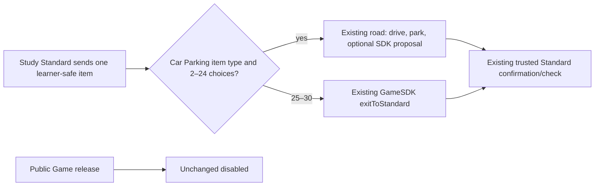

# Car Parking source: verified 24-bay bound and native Study Standard fallback
**Owner lane:** Agent 3 · Task SV-GAME-PARKING-OPTION-BOUNDS-001 · Session SV-A3-20261121-PARKING-BOUNDS-123 · November 21, 2026.

## Verified cause and actual change
The original Car Parking `normalizeMultipleChoice` accepted **all** Study Item option arrays of length >=2, whereas the same Game's `buildTrack` rejects values >24. The verified Study Standard Multiple Choice item adapter supports up to 30. Therefore a valid 25–30-choice Study Item could load, then throw while constructing the actual road after an item had already been accepted. The old startup catch showed Sample Available rather than deliberately requesting the existing Standard fallback.

The updated Car Parking author source now checks the local road limit **before** mounting: `normalizeMultipleChoice` supports only 2–24 options, and `createModuleSession.load` calls the existing `GameSDK.module.exitToStandard()` once when a compatible-type but over-cap item with 25–30 options arrives. It throws a clear module error only after requesting Standard. The normal valid 2–24 pathway, original driving/traffic/road physics, source CSS/HTML, question dialog, SDK response shape `{item_id,response:{value}}`, duplicate-submission guard, answer-key privacy and native Study Standard answer checking remain unchanged. This is not an additional grading endpoint.

## Architecture / before-after / UI

**Before:** oversize item loaded and failed inside `buildTrack` after UI setup.
**After:** oversize item gets an early clear "at most 24" error and a deliberate exit through the approved Module SDK; no private grader, no unverified answer or sample-mode replacement.
**UI design:** Adapt the existing Car Parking and StudyVerse private Standard design, no new routes, controls, standalone arcade or filename labels. Existing Exit to Standard handling is reused. User Manual stays unchanged: no new workflow, only a compatibility failure corrected.

## Integrity and source regression evidence
- Independently recomputed real UTF-8 byte sizes and SHA-256 for all **nine** author-source files in the existing `.studyverse/source-manifest.json`. All nine previously matched exactly. In particular, the initial apparent `String.length` discrepancy was **Unicode bytes**, not manifest corruption. No unnecessary repair.
- Only the modified `source/studyverse-session.js` was rehashed: previous **3415 bytes**, `4ce174a535703c356a56a4ad3c04ea46f7b8e133c66aa14ff65c3e4bdf34abf7`; new **4094 bytes**, `4e781679bfd9cc9f0f03bf4b92e92544b07684040193ea47386e3baae7919f4f`. Hash algorithm independently verified against SHA-256 known vector "abc". All other eight IDs, digests, sizes and paths and the source owner binding preserved.
- A new zero-dependency Node test suite reads and executes the actual source as ES modules via `data:` URLs without bundling or a new production dependency. Cases: accepted 2 and 24 options, rejected 25 and 30, approved Exit to Standard exactly once without answer submission for oversize, fixed type mismatch exit, single normalized private proposed choice without score/answer key, assisted route for 2/5/24 to each boundary bay, synthetic sample never grades or saves.
- **Tests actually performed this session:** Direct V8 source execution of the exact updated code verified 2/24/25/30 count behaviors, approved Exit to Standard, single SDK proposal, sample no-grade. Independent source-level 6 assisted-drive simulations reached valid parking-ready bays (2, 5, 24 bay counts; both first/last bay), with 114–358 bounded steps and no invented grading. The repo's new standalone native `node --test` suite was **written but not executed** in an actual Node checkout; do not claim it passed.
- The change is source-only in `studyverse-games/stage-1`; it does NOT update the existing immutable saved account Game v2, create v3, alter Study Sets/Items/JSON contracts or public Cloudflare/Workers/Pages deployment. Separate concurrent Agent 3 CSS/layout runtime task is untouched. Creator must use separately authorized source restore/build flow for a new immutable saved version before any real browser acceptance.

## Remaining steps / rollback
Actual native browser Car Parking CSS/layout, ResizeObserver/timers, source import/build into newly qualified immutable v3, Drive → Park → Exit user acceptance, signed release and revocation remain open. Public Game play and legacy flags stay locked. If this author-source change regresses, revert the one Game JS file and its manifest metadata together at exact previous Game repo commit `1a0a7798e09e9ed8da360c19f5216d17a23da949`; no DB, Study grading, source account/saved package or public runtime rollback.
