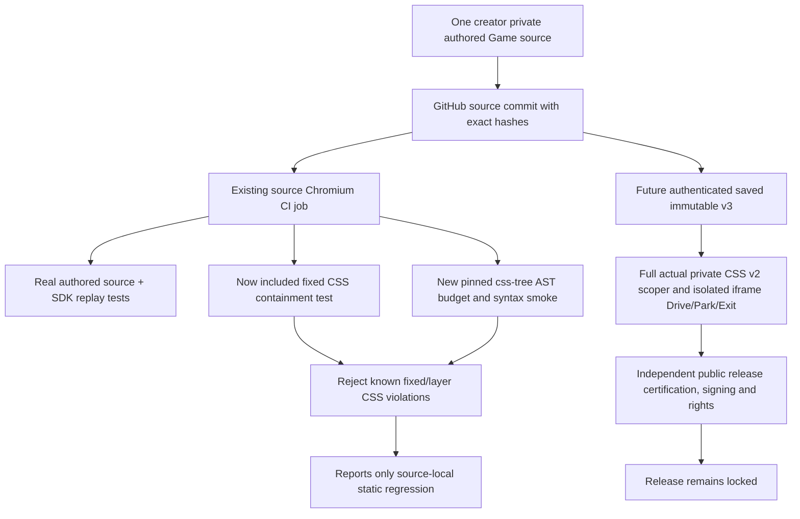

# Authored Car Parking CSS AST and CI regression integration

**Task** `SV-GAME-PARKING-CSS-AST-CI-001` · Agent 3 `SV-A3-20261123-PARKING-CSS-AST-CI-154` · 2026-11-23 Asia/Manila. **Author-source CI only; no saved v3, private player qualification or public Play.**

## Goals, exact cause and decisions

Prior author source fixed two definite private CSS-v2 containment failures: a `position:fixed` modal and z-index layers outside the approved `[-20,20]` range. The associated `private-css-v2-bounds.test.mjs` was committed, but the existing Car Parking GitHub Action job enumerates only **four specific test files** and omits it. A future source edit could reintroduce the exact rejected CSS and still pass the selected automatic test list. Additionally, no source-local automatic test has executed the **same pinned `css-tree@3.1.0` parser version** that the deployed creator-private CSS-v2 core uses to parse the complete two authored stylesheets.

Decision: Extend **only the already-existing private authored Car Parking Chromium rehearsal** to run the previously omitted CSS-bounds regression and a **new, composable, read-only CSS AST smoke test**. Install pinned `css-tree@3.1.0` alongside already-pinned `playwright@1.56.1`; no additional secret, cross-repo checkout, broad npm semver, new runner, new service, new schema, or source file/version mutation. Preserve fail-closed rules from actual production: never label a source-local smoke test as full `scopeStyledGameCssV2Core` approval. The full runtime parser includes extra selector/function/variable-proof/scoping checks **not reimplemented by these tests**.

## Before and after (general and specific logic)

| Component | Before | After |
| --- | --- | --- |
| Existing source CI command | Explicitly runs `module-contract`, `markup-profile`, `in-memory-source-loader`, `parking-browser` only | Adds the already-written `private-css-v2-bounds` and new `private-css-source-parse` to **same** native Node test invocation |
| Existing CSS regression | Stored in GitHub, not part of Actions job | Automatically included for source/CI changes; rejects fixed position or out-of-budget z-index |
| Authored stylesheet syntax | Reviewed manually but no complete v3.1.0 AST smoke | Parse the two actual authored CSS sources in **entry HTML link order** with strict parse-error reporting and explicit budgets |
| Security-sensitive CSS | Unknown new URL or non-media at-rule may be overlooked by regex | AST smoke rejects `Url` node, non-`@media` at-rule, oversize selector/declaration, fixed overlay and z-index range violations; no CSS network loading |
| Source identity | Existing nine manifest-pinned author files and immutable saved v1/v2 | Exactly unchanged; no source manifest, author JS/CSS bytes or Game SDK modified |
| Real saved Game / browser | Creator source Chromium is a native-DOM sample; private isolated iframe and saved version still unqualified | Same separation. No automatic login, new v3, signed receipt, public source, key, Grade/Study evaluator or buyer rights |

Specific AST test uses browser-safe Node pinned `css-tree@3.1.0`, calls `css.parse(source,{parseValue:true,parseRulePrelude:true,onParseError})`, walks `StyleSheet` AST, and bounds input ≤262144 bytes, rules ≤512, media ≤24, selectors ≤768, declarations ≤2400, individual selector ≤192 bytes and value ≤768 bytes. Those budgets are drawn from the current exact private CSS-v2 core and the established source-specific no-fixed and z-index limits. The test requires over 100 actual authored rules and over 200 declarations to catch missing/partial source, but does not claim output-scoping admission or CSS correctness itself. The actual runtime remains authoritative. No untrusted JS is evaluated in this test.

## Architecture

## UI design adaptation

**No new or changed UI.** This adds automatic source CI coverage, not a new application design. Existing slate/indigo Study Standard, Car Parking dark roadway, touch controls, full-game modal, responsive breakpoints, creator Studio, public player/Play label, source filenames and accessibility interactions are unmodified. No new end-user workflow; User Manual unchanged, also reserved under another active peer claim.

## Implementation, verification and rollback

1. Refresh frontend `main`, Worker and authored Game `stage-1` source heads, four existing live claims, unified backlog, binding owner account source/immutable-version and renderer-only Study SDK directives. Re-read actual local source CSS, current private CSS core, and existing Workflow explicit test invocation. **Done.**
2. Acquire one frontend coordination claim for only Game repo `.github/workflows/car-parking-browser.yml`, new `tests/private-css-source-parse.test.mjs`, this report and shared ledger using exact `expected_sha` with `force:false`. **Claim `2b4b02e5493e1fd367a90e4a6091f5742b33f6e9`.**
3. Change existing dependency installation to `npm install --no-save --no-package-lock --ignore-scripts playwright@1.56.1 css-tree@3.1.0`. No project runtime dependencies or lockfile changes. Include both bounded CSS tests in the existing Node `--test` command. Use the exact source CSS, not an unrelated synthetic fixture.
4. CAS-commit into existing author `stage-1`; read back exact Workflow/test bytes and check current release lock read-only. Observe native GitHub CI if provider returns results; do **not** assert tests passed if no confirmed result or runner unavailable. This source repo does not deploy Cloudflare Pages/Worker.
5. Record observed provider status, source-only limits and rollback, then release only own canonical claim with nonforce CAS. Leave four older peer claims intact.
6. **Later owner-dependent:** Build a new creator-authenticated *immutable* saved Game v3 from the corrected author source, run the **actual full private v2 CSS validator** and real isolated Drive → Park → Exit, then separately satisfy independent public runtime review/signing and guest rights. No direct DB writes or flags are authorized.

## Risks and limitations

- CI is **not** a public Play certificate. The source-only parser does not serialize/bound the full scoped CSS output, validate *all* selectors/values/function semantics, resolve static Grid repeat variables, authenticate an owner version, perform browser-native sandbox acceptance or prove learner SDK response checking. Those checks remain fail-closed in separate runtime policy.
- The GitHub Actions workflow includes an existing Playwright browser install; adding one small pinned parser to that existing dependency step avoids a separate runtime/CI lane and adds no network to the actual Game browser rehearsal.
- The job may not run due to unrelated GitHub Actions runner/quota/setup; wait for actual CI provider evidence before claiming success. No tests/CI claims are fabricated.
- The original past Space-key change was safe, but QuickJS actually had an `HTMLButtonElement` shim; its earlier claimed missing-constructor failure was incorrect. This task depends only on confirmed CSS source/CI omission.
- Rollback with nonforce Git CAS reverts the two test/Workflow files, leaving all authenticated account data, saved immutable versions, source CSS and existing production release authorization intact.

## Observed release evidence

- **Code/CI configuration commit:** [`4dee6c47dad2994f8690aca0ff7dd444b322131a`](https://github.com/georgekarlr/studyverse-games/commit/4dee6c47dad2994f8690aca0ff7dd444b322131a), direct nonforce expected-head CAS into existing private Game `stage-1`. No source project CSS/JS or manifest changes. The GitHub CI workflow blob `385b9826e8f8da53eac50f9e27d59a2601141bd2` reads back with **six** explicit source/Chromium tests (previously four), including both `private-css-v2-bounds.test.mjs` and `private-css-source-parse.test.mjs`, and pins `css-tree@3.1.0` alongside `playwright@1.56.1`.
- **New isolated AST source test:** GitHub blob `33481578fcee799065c606fbc60e22a536a07aa4` reads the exact two current authored stylesheets and invokes `css.parse` with the same pinned parser and strict parse-error collection. It checks static parser/structural budgets and known CSS fixed-overlay/layer/network bans; it does **not** import or falsely replicate the production CSS scoper. The preexisting source-bounds test blob `7b9b27f500693042e0155b1490aeda1d3df4be59` is unchanged.
- **GitHub provider test result:** The available combined commit-status endpoint returned **zero reported statuses** for the feature commit. **No successful GitHub Actions run, browser invocation, parser test result or Cloudflare deployment has been confirmed in this session.** Repository code readback confirms test wiring, **not** execution or acceptance. The existing private GitHub Actions runner may execute the job for this workflow/test change, but that has not been verified, so no pass is claimed.
- **Live SQL release readback:** `locked=true`; `executable_runtime_ready=false`; `entitlement_ready=false`; `release_signing_enabled=false`; legacy `official_grading_ready=false`. These flags were only read, not altered. User Manual remains unchanged, and no Game public Play rights or source exposure were created.
- **Still required:** actual full compiled CSS-v2 admission, genuinely owner-authenticated newly saved immutable v3 and real isolated Drive → Park → Exit, followed by separate independent public execution/signing/version-bound revocation and guest rights. **SV-RELEASE-GATES remains BLOCKED.**

