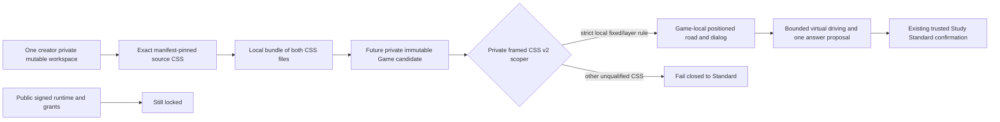

# Car Parking private styled-v2 CSS containment: authored overlay and layer bounds

**StudyVerse Development Agent 3** · `SV-GAME-PARKING-PRIVATE-CSS-V2-BOUNDS-001` · `SV-A3-20261123-PARKING-PRIVATE-CSS-V2-153` · November 23, 2026 Asia/Manila. **Mutable author source only. Neither saved v3 nor public Game playback.**

## Goals, binding decisions and verified specific root cause

The current real nine-file Car Parking author project includes `styles.css` and `focus-layout.css` as two local stylesheets. StudyVerse's actual in-repo compiled-source builder `src/lib/game-code-project-build-core.ts` imports both local stylesheets from the entry HTML using one bounded `esbuild-wasm` plugin and returns a single `sections.style`. The already deployed creator-private isolated frame validates **all** this compiled CSS through the restricted styled-v2 scoper instead of injecting arbitrary CSS.

The verified shared policy `scripts/game-review/public-styled-css-v2-core.mjs` refuses **any** `position:fixed` declaration (`fixed_overlay_forbidden`) and any `z-index` outside **-20 to +20** (`z_index_outside_local_budget`). The current authored `styles.css` had `.modal-backdrop{position:fixed;inset:0;z-index:100}`; the later `focus-layout.css` used `.hud z-index:30`, `.status-toast z-index:31`, `.game-controls z-index:32`. Thus these known values **cannot pass that specific private CSS v2 decision**, regardless of the result of other tests. Existing saved immutable v2 is separately known to have an older invalid Grid repeat-count; a mutable GitHub fix does not alter that saved artifact.

**Decision:** Adapt the current Game UI within its already-existing full-height, positioned, `isolation:isolate` `.game-shell`, rather than broaden the private runtime's containment allowlist, move the dialog into the StudyVerse parent document, or loosen CSS safety. The modal should cover only the Game frame, not the trusted host. Preserve relative visual priority and all existing responsive breakpoint styling.

## Before / after — precise logic and UI details

| Source behavior | Before | After |
| --- | --- | --- |
| Question dialog backdrop | `position:fixed`, outside safe local-scoping policy | `position:absolute;inset:0` inside existing `.game-shell` positioned full-height root, same full-Game covering behavior |
| Dialog layer | `z-index:100`, private-v2 reject | `z-index:20`, maximum local layer, remains above all controls/status |
| Driving HUD | `z-index:30`, private-v2 reject | `z-index:15`, above road, below status and input controls |
| Visible non-quiet status | `z-index:31`, private-v2 reject | `z-index:17`, above HUD; already non-interactive |
| Touch/pointer driving and Park controls | `z-index:32`, private-v2 reject | `z-index:18`, above status and HUD, below modal |
| All other CSS and runtime | Existing authored visual design and safe controls | Unchanged, including lane, cars, transparency, responsive values, keyboard/pointer and full source layout |

The authored CSS still has other layer values `-1,1,3,7,8,9,10,12,14` that already fit the private CSS v2 cap. The root `.game-shell` in **both** source stylesheets is positioned relative, with full viewport height and hidden overflow. The change preserves `inset:0` for the modal so it fills that same Game canvas; it does not create browser-wide overlays or an additional focus target. Accessibility/focus trapping remains in the authored read-only question dialog and the trusted private frame's existing policy.

**General logic:** The source project is mutable only within its creator account. Each source edit is SHA-256-pinned in `.studyverse/source-manifest.json`; a later authorized private builder may construct a new immutable app-version candidate from the *complete* bundled source. The current game input API remains one fixed `multiple_choice` learner-safe item `{id,item_type,schema_version,content}` without `answer_key`; the authored Game can only propose a selected response after deliberate Park. Existing Study Standard controls correctness and feedback. The separate General GameSDK multi-type workflow remains untouched.

## Architecture and design choice

**UI environment adaptation, not a redesign:** Maintain the original dark roadway, compact slate/indigo HUD, distinct traffic, touch arrows, full-size dialog, mobile landscape rules, readable focus outlines, Standard fallback and modal z-order. No new app title, filename, button, pane, public route, signed Play state or independent grader.

## Implementation and rollout steps

1. Refresh exact frontend `main`, backend `stage-1` and author Game `stage-1` heads; inspect canonical live coordination claims, owner Game workspace and renderer-only SDK rules, current creator-private CSS scoper, real saved-Game preflight and authored CSS. **Done; four existing peer claims are outside the CSS source and preserved.**
2. CAS-claim only the two mutable Game CSS files, their manifest metadata, one focused source regression file, this plan, and shared coordination. Do not touch the claimed Studio source editor, private runtime candidate origin, signer or Core ZIP paths. **Claim:** `18a8a37ee95d1caa2c49a972b636996009edca80`.
3. Edit the four **exact** existing source declarations above. Keep modal `inset:0` and established focus behavior; never change game logic or build trust limits.
4. Independently recompute the old GitHub source SHA-256 and UTF-8 byte lengths, cross-check both against the original nine-file manifest, update only their digest and byte-count fields. Verify known SHA-256 vector before trusting the implementation. Preserve the existing file identity, fixed type, owner binding and other seven exact file entries.
5. Add a composable native Node source-level regression test: no `position:fixed`, all CSS z-index declarations fit [-20,20], modal and HUD/control priorities remain correct, and the two CSS files match the manifest. This limited regression does **not** assert whole CSS v2 validation; run only if separately required. Do not claim tests were run if they weren't.
6. Commit directly to existing author `studyverse-games/stage-1` with non-force exact-head Git CAS. Read back source contents, SHA metadata and unchanged public DB lockdown. No Cloudflare build is expected, because this repo is author-source and **does not deploy the public/creator-private player on commit**.
7. Later **authorized** creator must import/rebuild this version into a new immutable saved v3 and prove actual private isolated renderer Drive → Park → Exit in the real browser, including complete stylesheet validator acceptance; only then consider independently reviewed public runtime, public signing authority and one-shot per-version guest right.
8. Release only this task's canonical coordinator claim with fresh frontend exact-head CAS and record actual verification. Keep all peer claims and User Manual unchanged: no new end-user workflow or deployed source.

## Risks, rollback and limits

- **Other CSS limitations remain possible:** `@media`, custom properties, pseudo selectors, specific `calc/var/repeat`, declarations and total source budgets are independently checked by the real CSS v2 parser. This fix is narrowly demonstrated for two certain deny predicates only; it is **not** a compiled v3, full CSS approval, signed package, browser E2E or public Play.
- Absolute positioning depends on the verified `position:relative` Game shell; both source stylesheets retain this. It cannot escape to the StudyVerse parent origin because the runtime already isolates the frame and forbids unsafe overlays.
- A physical browser screenshot/modal interaction and full layout parity still require the future signed-in private test, not a source regex alone.
- Rollback via non-force revert of the two authored CSS blob changes and their manifest SHA/byte records plus this regression file, leaving immutable saved Game v1/v2 unchanged. Never mutate saved versions in place or alter public Worker/runtime keys/SQL release flags. Existing User Manual remains valid.
- **Correction to preceding Space-key checkpoint:** The checked creator-private `input-guest-bootstrap.mjs` actually defines an `HTMLButtonElement` virtual compatibility class with `Symbol.hasInstance`. Therefore the prior source change replacing the constructor with `tagName` is a safe semantic simplification, **not verified evidence of an existing private-player keyboard failure**. This report does not rely on that incorrect inference.

## Actual source evidence

Initial genuine Game CSS blobs were SHA-256-matched to the manifest before any change. `styles.css`: **18847 bytes** old `0262b82b91f6c724372777f2e4773ce39e9543cfef3e89f835a20bff148e5d8d` → **18849 bytes** new `eb4ed9e9922fd6ea1478e8aca823d6d9157c6346b2790c58e40dffe209d7558f`. `focus-layout.css`: **7549 bytes** old `932593e776bb330e808e62bbcbf83a7eb1198ac036d407ad43db47a84a9ccb01` → **7549 bytes** new `6837f339d632583bda29e2b37e5caca078ae8bc4fea40ad69c1989d91a647d8e`. All CSS numeric z-index values were source-scanned and fell between -1 and +20 afterward. A new focused regression source file was added; no current release or live saved-version acceptance claimed.

**Final source commit and exact readback VERIFIED:** [`55f167cfe5692102ac2fa47f15d7dbce01402023`](https://github.com/georgekarlr/studyverse-games/commit/55f167cfe5692102ac2fa47f15d7dbce01402023) committed to the real authored Game `stage-1` using `expected_sha` and `force:false`. GitHub after-commit readback verified CSS blobs `2423a5cb0bff10e56cc43c2661c6ff090c8d0c68` and `ca48dc6dad99eeb5910f0122bc04dd97fa138c95`, manifest blob `fad2e154633f28deac004a911f52d3e742cc84aa`, and standalone source regression blob `7b9b27f500693042e0155b1490aeda1d3df4be59`. New hashes matched the manifest; original manifest has nine source entries and original logical IDs/fixed type. The edited CSS contains **zero** `position:fixed` values; its z-index values span **−1 through +20**. Exact UI ordering `modal 20 > controls 18 > status 17 > HUD 15` confirmed by source readback, with positioned Game shell intact. **The new Node regression test was committed but not executed manually**, and no native QuickJS/css-tree compiled package validation, actual saved package, real private browser or public Play was claimed. There is no Cloudflare/Pages/Worker production deployment from this authored source repository change.

**Post-feature live production SQL verification:** global `game_code_public_release_lockdown` still `locked=true`, `executable_runtime_ready=false`, `entitlement_ready=false`, `release_signing_enabled=false`, and legacy `official_grading_ready=false`. The latter is a legacy lock, **not** a mandate for a separate Game grader. No SQL update, signing, entitlement, public player code change or guest executable delivery occurred. Public Play remains **BLOCKED**. Full private CSS parser acceptance against a new immutable, owner-authenticated v3 and native Drive → Park → Exit are still outstanding.
