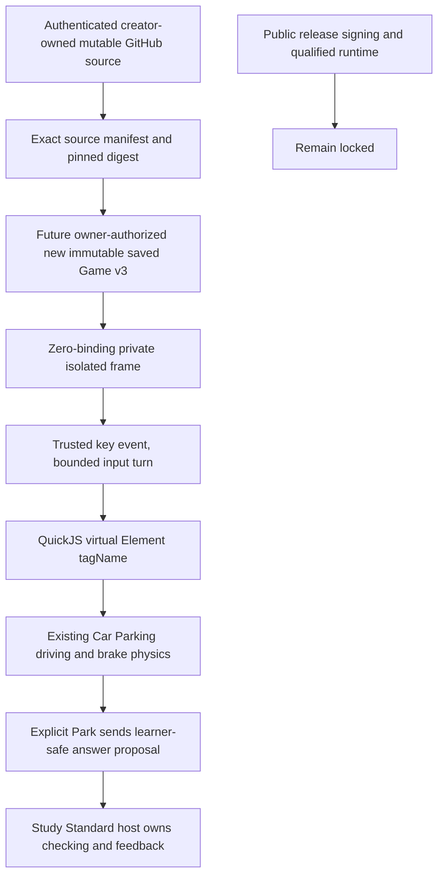

# Car Parking Space-key parity with isolated Game runtime

**Agent 3** · `SV-GAME-PARKING-SPACE-QUICKJS-001` · session `SV-A3-20261123-PARKING-SPACE-QUICKJS-152` · 2026-11-23 Asia/Manila

## Goals and current decision

Make the **real authored Car Parking source** compatible with its already deployed creator-private isolated keyboard-interpreter profile, without changing game mechanics, browser button activation, SDK answer privacy, reusable account-source architecture, immutable saved Game versions, the public player or any signing/Play authority. This source-only fix prepares (but does not create) a future immutable owner-submitted v3 and later independently qualified public Game.

**Specific observed cause:** The actual `main.js` global keydown listener tests `target instanceof HTMLButtonElement` before determining whether Space should brake. The private `input-guest-bootstrap.mjs` virtual Element implements `tagName` but deliberately exposes no `HTMLButtonElement` browser constructor. In QuickJS, the `instanceof` expression can throw a `ReferenceError` for Space, terminating a valid virtual keyboard turn. Arrow keys and the UI's button click implementation do not need this constructor. This is real source/runtime mismatch, not a hypothetical API rename.

**Decision:** Match the existing `tagName` field against `BUTTON` rather than using the unavailable native `HTMLButtonElement` constructor. Only the original keyboard condition changes. Space still activates a **focused button** through native keyboard behavior; Space otherwise applies the brake. A no-dependency source contract regression test detects any reintroduction of the browser-specific constructor. The exact mutable author file's UTF-8 size and SHA-256 are updated in its authoritative source manifest, leaving all other nine-file identities, bytes and manifest fields unchanged.

## Before / after, detailed implementation

| Topic | Before | After |
| --- | --- | --- |
| Global keydown `Space` inside isolated QuickJS | Refers to unavailable `HTMLButtonElement` constructor, potentially aborting input turn | Reads allowlisted `target.tagName`, compares normalized `BUTTON`; no constructor required |
| Space on a focused real/virtual button | Native button activation should not be hijacked by Game brake | Same explicit button exclusion preserved |
| Space on the focused Game viewport | Intended to brake but isolated virtual runtime could throw | Brake condition uses the existing semantic target and can call unchanged `driveKeys/syncControls` |
| Arrow/WASD navigation, touch arrows, physics, active traffic and Park | Original authored mechanics | Unchanged |
| Submission, fixed Study Item type, answer keys, SDK | `GameSDK.module.submitAnswer({item_id,response})` once after deliberate Park; no correctness in Game | Exactly unchanged; verified item type remains `multiple_choice` |
| Runtime/auth/release | Private input interpreter deployed; public executable runner/signer/guest grants blocked | All Worker/DB/Cloudflare/public locks unchanged |
| Version/source integrity | Mutable author SHA pinned in `.studyverse` manifest; immutable saved v1/v2 separate | New mutable author hash pinned only; saved packages and saved version count **not** changed |

**Specific source replacement:** `key===' '&&target instanceof HTMLButtonElement` becomes `key===' '&&String(target?.tagName??'').toUpperCase()==='BUTTON'`. No catch or silent fallback, fake constructor, native DOM exposure, unbounded input or gameplay logic fork.

**Source-byte integrity:** Original `main.js` SHA-256 `c33f86940fec451533fd5f6780313e59bbb6db797e933b1b69639e6757aa4fd9`, **9822 bytes**. New SHA-256 `d2604842d1d9fc4ec972c0b68b0b33ee898e2d4ac90642be545e783f69851197`, **9839 bytes**. Independently generated SHA-256 routine first matched known vector `SHA256("abc")=ba7816bf...`, then independently recomputed prior file digest/bytes and matched the manifest before modifying it. Other source manifest entries remain untouched.

## Architecture

## UI design adaptation

No new UI architecture or redesign. Preserve the actual Car Parking responsive driving road, arrow pad, in-game focus, modal and Park/Exit controls. The change corrects an existing documented keyboard mechanic; it adds no new user-facing option, file label, role, grading state or route. User Manual already describes keyboard controls and is reserved under another active session, so do not change it for this source-only fix.

## Steps, verification, deployment and rollback

1. Refresh `CStudyVerse/main`, Worker `stage-1`, authored `studyverse-games/stage-1` and four existing in-progress coordinator claims, binding fixed-type/renderer-only contract, API/bulk JSON and existing player source. **Done.** Current public SQL lock remains on; no source/API/title drift found.
2. Reserve only this Game source keydown file, exact manifest record, its existing source-test file, this report, and one cross-repo canonical coordinator row via frontend `expected_sha` and `force:false`. Keep other agents' protected frontend/Worker paths untouched.
3. Replace browser constructor dependency with virtual-Element-compatible semantic tag test. Recompute real UTF-8 SHA/size and update the manifest only for this source file; add a regression expectation without a new test dependency.
4. CAS-commit directly to `studyverse-games/stage-1` after refreshing its head. **No automatic change to creator-account/private Wasabi package, signed Game version, public runtime, Cloudflare or Supabase** follows from this source commit. Do not suggest this is a new v3 or a public Game release.
5. Source readback: confirm new keydown condition, manifest digest and all other pinned file records. Existing GitHub source browser rehearsal workflow may run automatically for the source change; report any actual CI result honestly, not as real isolated SDK/browser acceptance.
6. The owner must explicitly and authentically import/build/save this current GitHub source to a **new immutable v3**, then perform a genuine creator-private zero-binding player Drive → Space Brake → Park → Exit session. That and eventual independently approved public runtime, artifact signature, current guest grant and release key enrollment are **still outstanding**.
7. Rollback requires a normal nonforce revert of only the source keydown line, matching manifest digest/size and source regression file. Never roll back or alter older saved Game versions, fixed types, release key epochs, public grant lock, billing, or Study answer records.

## Acceptance limits

Actual source-level ABI root cause, safe replacement, previous/new cryptographic digests and Git source readback are verifiable; this does **not** run a genuine owner's saved Game in a browser or create a new immutable package. A local synthetic/author-source Chromium rehearsal and GitHub CI are separately labelled (never public or saved-Game acceptance). Public Play, source installation, checkout, signing and release authority stay blocked. No standalone Game grading or answer-key-bearing API exists.

## Actual source release evidence — 2026-11-23

- Authored Game branch source commit [`6af2d774964376e2bac0875acc5c7e97fd66e606`](https://github.com/georgekarlr/studyverse-games/commit/6af2d774964376e2bac0875acc5c7e97fd66e606) was committed with exact-head `expected_sha`, `force:false` to existing `stage-1`, not a parallel production/staging branch.
- GitHub readback confirmed source blob `0fc8f9484ac851f64eb11619f432672f617eb885`: the Space handler uses `String(target?.tagName??'').toUpperCase()==='BUTTON'` and contains **no** `instanceof HTMLButtonElement`. Existing keyboard, touch, parking, source and SDK flow otherwise unchanged.
- Source manifest blob `a3e5b20ca6349f0bc19edc782ba240b5a868f48e` records **9839 UTF-8 bytes** and exact **SHA-256 `d2604842d1d9fc4ec972c0b68b0b33ee898e2d4ac90642be545e783f69851197`** for the same logical source file ID. The old digest/size were independently matched before modification; all other author source manifest entry IDs/fields remain unchanged. The existing source-focused test `markup-profile.test.mjs` has a new regression assertion but **was not manually run** in this session.
- Current Worker Study Item authoring `item_type/content/sort_order/answer_key`, positive learner-safe fixed-type `{id,item_type,schema_version,content}`, no title in bulk JSON guidance, and separate General SDK docs were rechecked for genuine contract drift. **No mismatch or migration needed.**
- This source repository does not deploy a public player or modify existing private Game receipts automatically. The **private saved v1/v2**, optional new v3, genuine user acceptance, exact CSS approval, separate public executable origin and signature/guest-right releases remain unverified. No independent public execution or paid rights were enabled; no production Pages/Worker/Supabase deploy was performed in this task.
